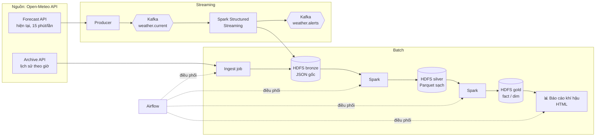
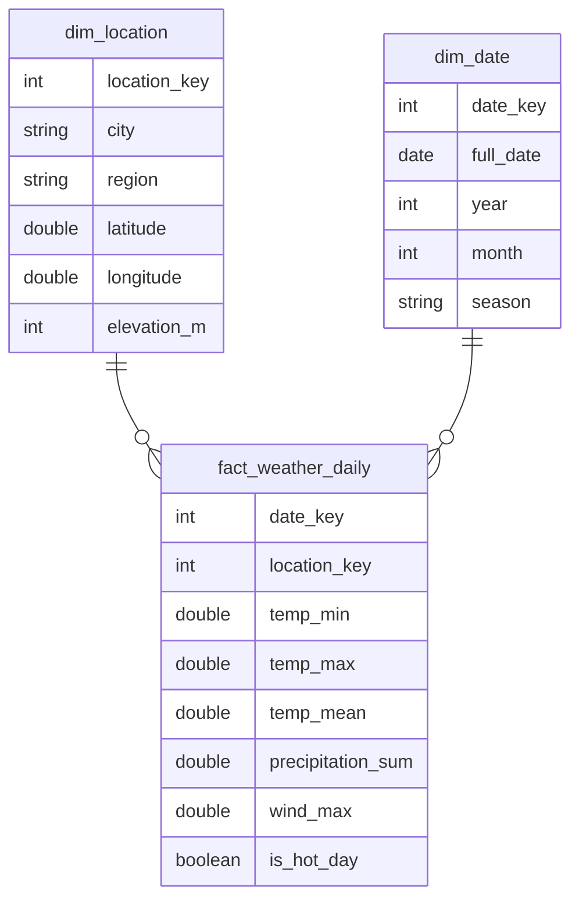

# 🌦️ Vietnam Weather Data Pipeline

Pipeline dữ liệu end-to-end phân tích **khí hậu 20 năm (2005–2025)** và **cảnh báo thời tiết real-time** cho 10 thành phố Việt Nam, xây dựng bằng Hadoop, Spark, Kafka và Airflow.


> 🚧 **Đang phát triển.** Hạ tầng đã dựng xong, các pipeline đang được xây dựng theo [lộ trình](#-lộ-trình).

## ✨ Điểm nổi bật

- **Batch:** xử lý ~1,75 triệu bản ghi thời tiết theo giờ bằng Spark, lưu trên data lake HDFS theo kiến trúc medallion.
- **Streaming:** thu thập thời tiết hiện tại mỗi 15 phút qua Kafka, Spark Structured Streaming phát cảnh báo nắng nóng, mưa lớn, gió mạnh.
- **Orchestration:** Airflow điều phối backfill 20 năm và pipeline hằng ngày (ingest → transform → kiểm tra chất lượng → báo cáo).
- **Hạ tầng dạng code:** toàn bộ cụm chạy bằng Docker Compose, mở được trên GitHub Codespaces mà không cần cài đặt.

## 🏗️ Kiến trúc



| Công cụ | Vai trò trong dự án |
|---|---|
| **HDFS** | Data lake 3 tầng: `bronze` (dữ liệu gốc) → `silver` (đã làm sạch, partition theo năm) → `gold` (bảng phục vụ báo cáo) |
| **Spark** | Làm sạch, chuẩn hóa múi giờ, tổng hợp ngày/tháng/năm, tính xu hướng và bất thường |
| **Kafka** | Nhận dữ liệu thời tiết hiện tại; key theo thành phố để giữ thứ tự trong từng partition |
| **Spark Structured Streaming** | Cửa sổ thời gian theo event time + watermark, phát cảnh báo khi vượt ngưỡng |
| **Airflow** | Lập lịch, phụ thuộc giữa các task, backfill theo năm, retry |
| **Docker Compose** | Dựng cụm theo profile (`hadoop`, `spark`, `kafka`, `airflow`) để tiết kiệm tài nguyên |

## ❓ Câu hỏi phân tích

| # | Câu hỏi | Kết quả |
|---|---|---|
| 1 | Mỗi thành phố đã nóng lên bao nhiêu °C trong 20 năm? | _đang thực hiện_ |
| 2 | Số ngày nắng nóng ≥ 35°C mỗi năm có xu hướng tăng không? | _đang thực hiện_ |
| 3 | Mùa mưa ba miền Bắc – Trung – Nam lệch nhau thế nào? | _đang thực hiện_ |
| 4 | Các đợt mưa cực đoan (> 100 mm/ngày) xảy ra khi nào? | _đang thực hiện_ |
| 5 | Tháng nào bất thường nhất so với trung bình nhiều năm? | _đang thực hiện_ |
| 6 | Thành phố nào có thời tiết dễ chịu nhất quanh năm? | _đang thực hiện_ |

**Phạm vi:** Hà Nội, Hải Phòng, Lào Cai, Huế, Đà Nẵng, Nha Trang, Đà Lạt, Buôn Ma Thuột, TP.HCM, Cần Thơ.

## 🗂️ Mô hình dữ liệu

**Medallion trên HDFS**

| Tầng | Định dạng | Nội dung |
|---|---|---|
| `bronze/` | JSON | Response gốc từ API, không chỉnh sửa, phục vụ chạy lại |
| `silver/` | Parquet, partition theo `year` | Dữ liệu theo giờ đã làm sạch, ép kiểu, chuẩn múi giờ `Asia/Ho_Chi_Minh` |
| `gold/` | Parquet | Star schema phục vụ báo cáo |

**Star schema (gold)**



## 🚀 Chạy nhanh

Cách nhanh nhất là **GitHub Codespaces** (không cần cài gì): bấm **Code → Codespaces → New with options → 4-core**, sau đó:

```bash
docker compose --profile hadoop --profile spark up -d
docker compose ps
```

Chạy trên máy cá nhân với Docker Desktop, danh sách profile, Web UI và xử lý lỗi: xem [docs/SETUP.md](docs/SETUP.md).

## 📁 Cấu trúc thư mục

```text
de-lab/
├── docker-compose.yml      # Cụm Hadoop, Spark, Kafka, Airflow (chia theo profile)
├── hadoop.env              # Cấu hình core-site / hdfs-site / yarn-site
├── .devcontainer/          # Cấu hình GitHub Codespaces
├── airflow/
│   ├── Dockerfile          # Airflow + Java + Spark provider
│   └── dags/               # DAG điều phối pipeline
├── spark/jobs/             # Spark batch & streaming jobs
├── kafka/                  # Producer
├── data/                   # Dữ liệu mẫu
└── docs/                   # Tài liệu cài đặt, hình ảnh
```

## 🗺️ Lộ trình

- [x] **Giai đoạn 0 – Hạ tầng:** Docker Compose cho HDFS, Spark, Kafka, Airflow; chạy trên Codespaces
- [ ] **Giai đoạn 1 – Ingest:** nạp dữ liệu lịch sử từ Open-Meteo vào HDFS bronze
- [ ] **Giai đoạn 2 – Transform:** Spark bronze → silver → gold, trả lời câu hỏi 1–3
- [ ] **Giai đoạn 3 – Orchestration:** DAG backfill + DAG hằng ngày, sinh báo cáo HTML
- [ ] **Giai đoạn 4 – Streaming:** Kafka producer + Spark Streaming phát cảnh báo
- [ ] **Giai đoạn 5 – Hoàn thiện:** câu hỏi 4–6, star schema, kiểm tra chất lượng dữ liệu

## 📚 Nguồn dữ liệu

Dữ liệu thời tiết từ [Open-Meteo](https://open-meteo.com/) (Historical Weather API dựa trên ERA5 reanalysis và Forecast API), giấy phép [CC BY 4.0](https://creativecommons.org/licenses/by/4.0/).
Số liệu là dữ liệu mô hình theo ô lưới nên có thể lệch nhẹ so với trạm đo thực tế.

## 👤 Tác giả

[lamntg3625@gmail.com](mailto:lamntg3625@gmail.com) · [GitHub @lamnt01](https://github.com/lamnt01)
